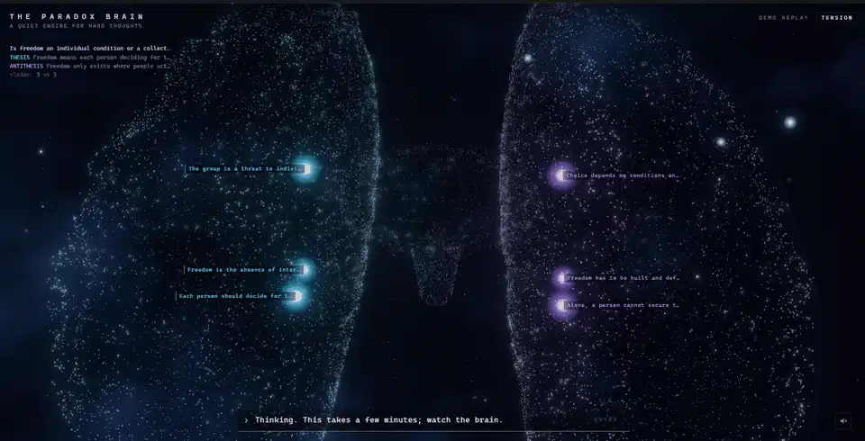

# The Paradox Brain

*A quiet engine for hard thoughts.*

> **Pre-release, v0.13.0-pre.** This is a working research prototype, published as it stands. It does what it was built for (getting past "both sides have a point") better than a plain chatbot, and it still loses to [Hegelion](https://github.com/Hmbown/Hegelion) on depth. The numbers, including where it loses, are in [the benchmark](#the-benchmark). Work on the next version continues.



The Paradox Brain works through opposing arguments. It finds the point where they actually clash and builds a resolution that goes past compromise. A language model left to itself settles every conflict the same way ("both sides have a point, balance is key"), and Paradox is built so that answer scores zero.

It has two modes. Blue mode answers hard questions: dilemmas, paradoxes, arguments you want taken apart. Red mode settles contradictions between sources: give it two claims, or two whole reports as PDF or Word files, and it tells you whether they genuinely contradict each other, hold under different conditions, or don't say enough to decide.

It runs on your own machine, with whatever language model you choose.

## How it works

Two models do two separate jobs.

The language model writes. It can be anything behind an OpenAI-compatible endpoint: Ollama, LM Studio, llama.cpp, vLLM or a cloud API. The default is `qwen2.5:7b-instruct` on Ollama; the benchmark below ran on Qwen 3.8 27B through Groq.

The NLI model judges. It is a DeBERTa-large cross-encoder trained on adversarial inference data, and it answers one question about a pair of sentences: does the second contradict the first, follow from it, or say nothing about it? It has no opinions to talk it into, so the writer never grades its own work. Smaller NLI models were tried and dropped, because they flag any sentence that mentions both sides as a contradiction, which makes them useless for judging a synthesis.

### One answer

1. Draft: the language model answers the question plainly. This is raw material, not the answer.
2. Map: the disagreement gets pinned down. Both positions, the short claims each one rests on, the crux they turn on, and what would settle it.
3. Tension: the NLI model scores every claim against every other one and finds the core clash.
4. Oppose: the strongest case against the draft, written as its best defender would write it.
5. Resolve: the model thinks the resolution through, out of sight, and code checks that thinking before anything is written: it has to name a kind of question, say what each side gets right and wrong, avoid hedges, and arrive somewhere neither side started from. If it fails the check it gets one more try.
6. Write: from that checked resolution it writes one answer: the verdict in the first two sentences, what it turns on, each side at full strength, the resolution that keeps what is true in both, one concrete case that makes it click, and the price: what the verdict costs and who pays.

Code checks the answer before you see it: it has to stay within 650 to 1,000 words, it can't repeat itself, it can't talk about its own process, and the verdict has to come first. If it fails twice, Paradox falls back to its earlier form of answer.

The shape of the answer follows the kind of question:

| Kind | What a strong answer does |
|---|---|
| Hidden premise | names the assumption that fails, early, shows why it seemed true and what replaces it |
| Surprising truth | says plainly that the strange conclusion is right, then shows why it only looks absurd |
| Broken concept | shows which concept breaks under the strain and what repair works |
| Two meanings | splits the word into its meanings first, then settles the real question left over |
| Trade-off | gives the rule for where the line goes, the price paid at that line and who pays it |
| Facts | says what the evidence shows, how big the effect is, and when it flips |

### Red mode

Two claims go straight to the resolver. Two reports go through the report layer first, which reads PDF and Word files, picks out each report's findings, and pairs findings that talk about the same thing using the embedding and NLI models. No language model is involved in reading or pairing. Each clash it finds then goes to the resolver, which decides between three outcomes: a genuine contradiction (the two measure the same thing the same way and still disagree), different conditions (they measure different things, such as a median against a 99th percentile, or one year against five), or not enough information to tell. The reports' overall verdict follows from their clashes by rule.

### In conversation

A new claim, question, dilemma or paradox runs the full dialectic. If you push back, your objection becomes the antithesis and the last synthesis becomes the thesis, so you take the opponent's seat. Asking "why?" gets a walk through its own reasoning; it does not explain itself unless asked. Ratings from 1 to 5 are stored with each answer.

### Memory

Every resolved tension is stored with its embedding in one SQLite file in `~/.paradox/`. When a related question comes up, related conclusions come back with it. It learns slowly and forgets rarely: it only drops conclusions you rated badly, or ones that went unused for six months and scored poorly.

## Using it

You bring the language model: a free local one through Ollama, or your own API key for a hosted one (Groq, Google Gemini, OpenAI, anything OpenAI-compatible). Copy `.env.example` to `.env` and fill in one block. With no `.env`, Paradox uses Ollama with `qwen2.5:7b-instruct`.

Then start it:

| | Conversation in the terminal | The brain in your browser |
|---|---|---|
| Windows | double-click `Start Paradox.bat` | double-click `Start Paradox Brain.bat` |
| Mac (Apple Silicon or Intel) | double-click `Start Paradox.command` | double-click `Start Paradox Brain.command` |
| Linux (x86-64) | `./start.sh` | `./start.sh --brain` |

The first run sets up a private copy of Python 3.12 and the libraries Paradox needs, all inside this folder; deleting the folder removes everything. It only installs Ollama and downloads a local model if your `.env` points at Ollama (or you have no `.env`); with an API key set, nothing large is downloaded except the two judging models (about 1 GB). On Mac and Linux, install [Ollama](https://ollama.com/download) yourself first if you want a local model.

On a Mac, the first time you open a `.command` file macOS may say it is from an unidentified developer: right-click it, choose Open, then Open again. After that a double-click works.

```
you  Freedom requires individualism. Freedom requires collective action.
  · core clash ...          (with --trace, each phase shows as it happens)
paradox  ...
you  /why
you  4                      (rate the answer 1-5)
```

Commands: `/why` explains the last answer, `/trace` shows the raw reasoning with no model in between, `/rate N [note]` or a single digit rates it, and `/quit` exits.

Any OpenAI-compatible endpoint works: Ollama, LM Studio, llama.cpp's server, vLLM, OpenAI, Groq, Gemini. `.env.example` has ready blocks for the common ones; the settings are:

```
PARADOX_LLM_URL=http://localhost:11434/v1
PARADOX_LLM_MODEL=llama3.1:8b
PARADOX_LLM_KEY=ollama
PARADOX_MAX_DEPTH=2          # dialectic rounds
PARADOX_PATTERNS=2           # moves tried per round
```

### The brain

Start it with the brain launcher above and it opens http://localhost:8100. You start outside a brain floating in a dark nebula. When you ask something, the camera dives inside and every phase of the thinking plays out where it happens: claims form as stars in the left and right hemispheres, contradictions arc between them, the ring of moves lights up, candidates cross the corpus callosum, and the winning synthesis collapses everything into a supernova before the answer assembles. Sound is off by default.

A switch in the corner flips between blue mode and red mode; in red mode you type two claims or drop in two report files.

The same API serves anyone who wants to build their own front end: `POST /api/chat` streams one event per thinking phase and then the reply, `POST /api/resolve` settles two claims, and `POST /api/resolve_reports` takes two files.

## The benchmark

Paradox is tested against the plain model: the same language model answering in one call as a thoughtful assistant. The question set is 20 prompts covering classic paradoxes, ethics, politics from several directions, economics, science, art and personal decisions.

A judge model (gpt-oss-120b) compares each pair of answers blind, twice, with the order swapped, and a system only wins a criterion if it wins in both orders. That cancels the judge's habit of preferring whichever answer it reads first, and it is why there are so many ties. The criteria are steelmanning both sides, finding the crux, getting past compromise, honesty about costs, consistency, economy of words, and insight (after reading it, do you understand why the problem arose and why it is settled).

### Where it stands

All runs below used Qwen 3.8 27B (through Groq) as the language model for every system, and gpt-oss-120b as the judge.

**Against the plain model, version 13** (this release; 11 of the 20 questions, the run was cut short by the free tier's daily limits):

| Criterion | Paradox wins | Plain wins | Tie |
|---|---|---|---|
| Overall | 4 | 3 | 4 |
| Beyond compromise | 8 | 2 | 1 |
| Crux | 5 | 1 | 5 |
| Honesty | 2 | 2 | 7 |
| Insight | 3 | 3 | 5 |
| Steelman | 3 | 3 | 5 |
| Economy | 0 | 6 | 5 |
| Consistency | 0 | 1 | 10 |

**Against the plain model, version 12** (all 20 questions):

| Criterion | Paradox wins | Plain wins | Tie |
|---|---|---|---|
| Overall | 8 | 4 | 8 |
| Beyond compromise | 12 | 0 | 8 |
| Crux | 9 | 2 | 9 |
| Honesty | 8 | 1 | 11 |
| Insight | 6 | 1 | 13 |
| Steelman | 5 | 8 | 7 |
| Economy | 0 | 4 | 16 |
| Consistency | 0 | 0 | 20 |

**Against Hegelion, version 12** (all 20 questions):

| Criterion | Paradox wins | Hegelion wins | Tie |
|---|---|---|---|
| Overall | 7 | 8 | 5 |
| Crux | 10 | 4 | 6 |
| Honesty | 8 | 3 | 9 |
| Economy | 18 | 0 | 2 |
| Steelman | 6 | 6 | 8 |
| Insight | 4 | 10 | 6 |
| Beyond compromise | 0 | 14 | 6 |
| Consistency | 0 | 1 | 19 |

What this says, plainly. Against a plain chatbot, Paradox does what it was built for: it gets past compromise, finds the crux, and is more honest about costs. It runs longer, so it loses on economy. Against Hegelion it is close overall: it finds the crux more often and says it in half the words (684 against 1,364), but Hegelion's long, explicit thesis-antithesis-synthesis wins clearly on getting past compromise and on insight. That gap is the open problem. Version 13 added a checked resolution step aimed at it; on the questions judged so far it beats the plain model on getting past compromise 8 to 2, but against Hegelion it has not closed the gap yet. Full outputs: [`docs/results_v12.txt`](docs/results_v12.txt), [`docs/results_v13.txt`](docs/results_v13.txt).

Red mode was tested on 15 pairs of conflicting claims with a known right outcome, and on 3 pairs of generated PDF reports.

| | Paradox | Plain |
|---|---|---|
| All 15 claim pairs | 13 | 10 |
| Different conditions (8) | 8 | 6 |
| Genuine contradiction (4) | 2 | 4 |
| Not enough information (3) | 3 | 0 |
| PDF report pairs (3) | 3 | not tested |

The plain model calls nearly everything a contradiction, which is why it gets all the real contradictions and none of the cases where there is too little to decide. Paradox is right more often, and genuine contradictions are where it still misses.

[Hegelion](https://github.com/Hmbown/Hegelion) runs its own thesis, antithesis and synthesis prompts in three calls on the same model.

The red-mode numbers above are from version 12. Version 13 changed how the resolver treats two claims about the same data source, and added five held-out cases to the set (20 now); those have not been scored yet.

## Hardware

| | |
|---|---|
| GPU | 6 GB of VRAM runs a 7B model (GTX 1660 Ti) |
| CPU | runs the NLI and embedding models and leaves the GPU to the language model |
| RAM | 16 GB |
| Disk | about 6 GB: 4.7 GB for the language model, about 1 GB for the judging models |

One answer takes five model calls, sometimes six when a check sends a step back. In the benchmark on Groq's free tier that came to about five minutes an answer, against under a minute for the plain model and about six for Hegelion, and much of that was waiting on rate limits. Running locally on a 1660 Ti has not been timed for version 13. It is a tool for hard thoughts, not quick ones.

## Why it exists

- Most debate is performance. This is dissection.
- Language models are either too large or too simple. This balances.
- I wanted something that doesn't flatter, only processes.

## Limitations

- Struggles with humour
- Doesn't handle raw emotion well
- Will not pretend to care
- It knows only what the language model under it knows. The structure keeps it honest, not omniscient.

## What's next

- Close the gap with Hegelion on getting past compromise and on insight, without giving up the shorter answers.
- Finish the version 13 runs (all 20 questions against both opponents) and score the new red-mode cases.
- A second judge model, so the results don't rest on one judge's taste.

## What's in this repository

Paradox's own code ships compiled: the files in `bin/` are machine code built from the source for each system, not Python you can read. The launchers, the brain's interface and the settings file are plain. The full source and the benchmark harness stay private.

## Licence

The Paradox Brain is released under the [PolyForm Noncommercial License 1.0.0](LICENSE.md). You can run it and share it for noncommercial purposes: personal study, research and testing, hobby projects, and use by charities, schools, universities, public research bodies and government institutions. Using it in a commercial product or service, or inside a company for commercial work, needs a separate commercial licence. For that, open an issue titled "Commercial licence" on this repository.

## Contact

Not provided. If you understand the tool, you'll know how to improve it. If you don't, no explanation will suffice.
